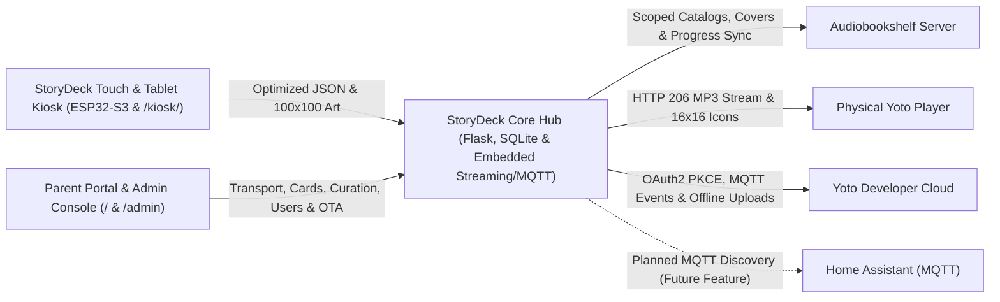
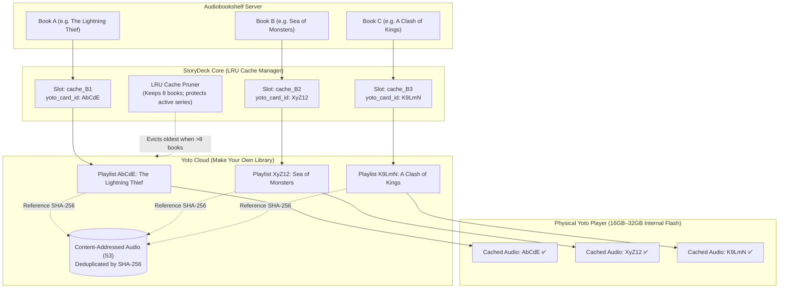

# StoryDeck Core

An open-source, community-ready smart hub and middleware broker that connects bedside hardware companion controllers ([**StoryDeck Touch**](https://github.com/YotoStoryDeck/StoryDeck-Touch)), **Audiobookshelf (ABS)** audio libraries, and physical **Yoto Players**.

StoryDeck Core unifies real-time MQTT telemetry, on-the-fly MP3 streaming, offline Yoto playlist uploads, catalog curation, multi-user profiles, thumbnail downscaling, remote Touch OTA firmware updates, and a mobile-first Parent Portal inside a single container.

---

## 🧩 Architecture Lineage & Foundations

StoryDeck Core integrates and builds upon foundational work from the open-source community:

1. **Hardware & Touchscreen Appliance:**
   * **Upstream:** [jayheavner/yoto-esp32-controller](https://github.com/jayheavner/yoto-esp32-controller)
   * **Attribution:** Created the original ESP32-S3 firmware, LVGL UI architecture, and 3D printable bedside enclosure for the Waveshare 4.3" panel.
2. **Audio Streaming & Two-Way Progress Sync (Now Integrated into Core):**
   * **Upstream:** [mylacc/yoto-audiobookshelf-bridge](https://github.com/mylacc/yoto-audiobookshelf-bridge)
   * **Attribution:** Pioneered the dynamic `ffmpeg` HTTP 206 MP3 streaming architecture, silence-snapped chapter splitting, offline track uploading, and MQTT bidirectional Audiobookshelf progress sync now integrated directly inside StoryDeck Core (`core/bridge/`).
3. **StoryDeck Core (This Hub):**
   * **Role:** Single-container orchestration server combining embedded Yoto Cloud streaming & MQTT telemetry with a mirrored collapsible-sidebar Parent Portal (`/`) and Admin Console (`/admin`), microcontroller-optimized JSON APIs, tag/series curation, multi-user profiles, SSO-ready user management, travel proximity detection, device quarantine, and remote OTA firmware management.



---

## 🚀 Key Features

* **Parent Portal (`/`) & Mirrored Admin Console (`/admin`):** Centralized collapsible left sidebar navigation and self-service **✏️ Profile** modal (`templates/_sidebar_and_profile_modal.html` + `static/js/sidebar.js`) shared across the Parent Portal and Admin Console, with a live Core status & version indicator and automatic offline alerts if Core becomes unreachable.
* **Bedside Player Controls, Physical MYO Card Pairing & Profile Avatar Carousel:** Quick-switch **Profile Avatar Carousel** (including personal **`🎧 My ABS`** listening override and dedicated **Personal User Card** `user_<uid>` for signed-in users, plus ephemeral `guest_stream` playlists for unregistered LAN guests) paired directly with the **Target Yoto Player** selector (`🟢`/`🔴` status indicators, separated `Default` / `Online` badges, and cover-art **MQTT Playback Confirmation Overlay**), full `0–100%` volume slider showing the Yoto App day/night volume limit, scrub seek, `±30s`, speed, sleep timers, Continue Listening, unified **ABS + Yoto (Retail & MYO) Library** browser with strict audio-only filtering (`ABSClient.is_valid_audio_item`), last-played chapter suggestion (`suggested_chapter`), and source filter (`All Sources`, `Audiobookshelf`, `Yoto Cards & MYO`) matching the Tablet Kiosk catalog, live MQTT **Pair Physical Card / Re-Pair** (`Editable MYO` & blank `hMkni` detection) with permanent card nicknames, Primary & Fleet Card switcher (`⚡ Stream` ↔ `⏱️ 5h Offline Window` ↔ `💾 Whole Book Offline` ↔ `📚 Series Offline`), and Yoto Cloud playlist manager.
* **Dedicated Users & Access Management (SSO, OIDC & Audiobookshelf Auto-Linking):** Standalone Admin **Users & Access** page featuring Primary Super Admin protection for the initial setup account, 3-tier roles (`guest`, `member`, `admin`), automated email/username **Audiobookshelf Account Auto-Matching & Scoped API Key Minting/Revocation** (`POST /api/api-keys` with Master Key Admin/Root permission checks, automatic master-key fallback on `401/403`, and self-service policy toggle), optional Trusted LAN / Sitter access, unified household sign-in (`/login`, with `/admin/login` alias) offering a dynamic **Sign in with [Provider]** button, Reverse-Proxy ForwardAuth, and full **Native OpenID Connect (OIDC) Authorization Code + PKCE (`S256`)** flow (`Authentik`, `Authelia`, `Keycloak`, `Pocket ID`, `Cloudflare Access`, or generic OIDC/SSO) with `groups` role sync and `post_logout_redirect_uri` return redirects.
* **Consolidated Streaming, 5-Hour Rolling Offline & Native MQTT Engine (`core/bridge/`, `clients/abs/`):** Embedded `ffmpeg` 64kbps mono HTTP `206` MP3 streamer with pre-encoded 5-second `WarmBuffer` warm starts, silence-snapped chapter cuts (`QuietSpots`), 99-track sliding window (`window_start`, step `90`), tap-time ABS resume with pause-without-`Range` resume (`2s`/`15s` rewind) and 2.5s silent MP3 + MQTT chapter auto-jump, multi-book **Series Cards** with automatic book advance, 3 offline upload modes (`offline_next` 5-hour rolling window with $\le 5\text{h}$ whole-book shortcut and 1.5h chapter-snapped bedtime lookback, `offline_book` whole book, and `offline_series` whole series) with live 5-track hybrid mixed playlists (`save_mixed_playlist`), startup interrupted-job auto-resume with boundary track byte/duration integrity verification (`resume_interrupted_jobs`), in-place physical `yoto_card_id` preservation with warm SHA reuse & series-aware LRU pruning, `own_place` local SQLite progress isolation (`bridge_slots.local_progress`), Yoto CDN cover & content-digest deduplicated 16×16 chapter icon uploads with `resolve_source_chapter_idx()` custom icon resolution for split/multi-book tracks, modularized `core/bridge/` (`offline_planner.py`, `offline_sync.py`, `offline_pruner.py`, `playback_sync.py`, `manager_cards.py`) and `clients/abs/` (`client.py`, `users.py`, `library.py`, `progress.py`), Audible/Audnexus Chapter Finder (`chapter_finder.py`), and Old MYO Card-to-ABS Viterbi Position Transfer (`transfer.py`).
* **Microcontroller-Optimized APIs & Integrated Tablet Kiosk:** 100% backwards-compatible ESP32-S3 Touch endpoints (`/api/kids/<child>/abs`, `/api/kids/<child>/yoto`, 100×100 thumbnails) alongside an additive single-request `GET /api/kids/<child>/catalog` endpoint for `/kiosk/`, plus a zero-CDN self-contained Tablet Kiosk (`static/kiosk/fonts/fredoka-latin.woff2`), stale-while-revalidate per-profile catalog cache, in-place telemetry & `PlayerScreen.tick()` updates (zero 5s DOM wipes), Screen Wake Lock API, `100dvh` edge-to-edge viewport & safe-area insets, interactive pointer-drag scrub/volume & `±30s` skip, portrait/large-tablet layouts & fluid Night Clock, client-side search & `All`/`ABS`/`Yoto` filter chips, profile and player-scoped **Recently Played** (`device:<id>` history), and server-enforced sleep timers.
* **Multi-User Profiles & Curation Matrix:** Separate libraries, ABS user scoping, daily discovery limits, physical card ownership tracking (`has_physical`), atomic whole-series rotation, and manual **Yoto Card Series & Sequence Overrides**.
* **Device Registration & Remote OTA Firmware Management:** Native zero-PIN hardware onboarding, automatic quarantine, rotating per-device JWTs, Core-hosted firmware repository with 1-click push/rollback OTA updates, and remote Touch MicroSD cache maintenance.
* **Network Proximity & Travel Protection:** Automatically detects whether a Yoto player is on the home network or traveling away, disarming bedtime sleep timers to protect roaming players.

---

## 📻 Yoto Hardware Offline Retention & Multi-Playlist Architecture



> [!NOTE]
> **Hardware Flash Caching & Offline Retention:** Yoto Player hardware indexes downloaded audio tracks by `cardId`. Overwriting a single reused playlist ID purges the player's local flash cache for that card, forcing Wi-Fi re-downloads when switching between books. To ensure true offline retention for recently played ABS content, StoryDeck Core maintains distinct Yoto Cloud playlists per retained book up to the profile's `offline_retention_limit`, utilizing Content-Addressed Storage (CAS) so audio is never duplicated on Yoto S3 while the player's internal flash cache remains 100% warm.

### 1. Dual-Layer Storage & Deduplication Mechanics
* **Zero Audio Duplication (Content-Addressed Storage):** When audio files are transcoded and uploaded to Yoto Cloud, each track is stored by its SHA-256 hash. If Book A is listened to by multiple profiles, or re-accessed after months, StoryDeck never re-transcodes or re-uploads audio bytes. Yoto Cloud's S3 stores exactly one copy of each audio block.
* **Per-Profile Playlist Isolation:** Even though audio is shared, each profile maintains its own playlist IDs in Yoto Cloud. This isolates playback progress and bookmarks so siblings reading the same title do not overwrite each other's reading position.
* **Automated LRU Cache Pruner:** Enforces `offline_retention_limit` (default: 8 books per profile). When a child starts a 9th book, the pruner deletes the oldest evicted playlist from Yoto Cloud while protecting active whole series atomically.

### 2. Playback & MYO Card Workflows

| Mode | Playback Trigger | Yoto Player Caching Behavior | Ideal Use Case |
| :--- | :--- | :--- | :--- |
| **Multi-Playlist Fleet (Default)** | Touch Controller, Tablet Kiosk, or Parent Portal | **100% Flash Retained.** Plays instantly from hardware flash storage without downloading. | Daily home listening, offline travel, road trips, car rides. |
| **Dedicated MYO Cards** | Physical plastic card inserted into Yoto Player | **100% Flash Retained.** Linked once via the official Yoto app to the book's Yoto Cloud playlist. | Child's favorite books or whole series kept on dedicated cards. |
| **Magic Profile Card (`primary_card_id`)** | Single plastic card inserted into Yoto Player | **Dynamic In-Place Overwrite.** Repointed using cached SHA-256 hashes in <1s. Requires 1 Wi-Fi sync after swapping before traveling offline. | Families with limited blank MYO cards wanting 1 "daily driver" card. |

### 🔮 Planned / Future Features
* **Home Assistant MQTT Integration:** Automatic entity discovery for bedtime screen locks, now-playing sensors, and automation switches.
* **Multi-Interval Bedtime & OK-to-Wake Schedules:** Core-synced weekday/weekend schedule overrides for bedside controllers.

---

## 🛠️ Quick Start & Deployment

### Option 1: Docker

Run StoryDeck Core directly using official container images from GitHub Container Registry (GHCR):

1. **Create an application directory, `.env`, and `docker-compose.yml`:**
   ```yaml
   services:
     storydeck-core:
       # For latest stable production release:
       image: ghcr.io/yotostorydeck/storydeck-core:latest
       # For specific releases or dev builds, specify the tag:
       # image: ghcr.io/yotostorydeck/storydeck-core:v1.1.0
       # image: ghcr.io/yotostorydeck/storydeck-core:dev
       container_name: storydeck-core
       restart: unless-stopped
       ports:
         - "${PORT:-5055}:5055"
       env_file:
         - .env
       volumes:
         - ./data:/app/data
         - ./cache:/app/cache
   ```

2. **Launch the container:**
   ```bash
   docker compose up -d
   ```

---

### Option 2: Local Development (Python 3.10+)

For local development and testing:

```bash
git clone https://github.com/YotoStoryDeck/StoryDeck-Core.git
cd StoryDeck-Core
python -m venv venv

# Windows PowerShell:
.\venv\Scripts\Activate.ps1
# Linux / macOS:
# source venv/bin/activate

pip install -r requirements.txt
cp .env.example .env
# Edit .env (set SECRET_KEY and optional initial credentials)
python app.py
```

Once running, StoryDeck Core will be available at `http://localhost:5055`:
* **Mobile Parent Portal:** `http://localhost:5055/`
* **Household Sign-In:** `http://localhost:5055/login` *(supports SSO/OIDC and local accounts; `/admin/login` alias also supported)*
* **Admin Dashboard:** `http://localhost:5055/admin` *(opens `/admin/setup` on first boot)*
* **Tablet Kiosk:** `http://localhost:5055/kiosk/` *(Fully self-contained in `static/kiosk/` — zero external asset dependencies; runs edge-to-edge on iPads, Android tablets, Fire OS, and desktop browsers).*

### Testing & Continuous Integration

* **Synthetic unit suite (default, CI-safe):** Runs all 117 unit tests under `NetworkGuard` with an ephemeral SQLite DB, requiring zero local `data/broker.db`, credentials, or external servers:
  ```bash
  python scripts/run_tests.py --unit-only -v
  ```
* **Optional sanitized local DB snapshot suite:** Clones a local `data/broker.db` strictly read-only (`?mode=ro`) into temporary storage and scrubs all secrets, tokens, emails, and LAN IPs before running unit + snapshot validation (never mutating the source DB):
  ```bash
  python scripts/run_tests.py --with-local-db -v
  ```
* **GitHub Actions CI:** [ci.yml](.github/workflows/ci.yml) runs on every push and pull request to `main` and `dev`, validating Python 3.11 + `ffmpeg` against `--unit-only -v` and checking all frontend JavaScript (`static/kiosk/js/*.js`, `static/js/*.js`) with Node 24 `node --check`.
* **Test Authoring & Architecture Guide:** See [tests/README.md](tests/README.md) for isolation rules, sanitization details, and test suite lessons learned.

---

## 🤖 AI Development Notice

This project utilizes artificial intelligence (AI) tools, including Anthropic Claude and Google Gemini / Antigravity, to assist in architectural design, code generation, refactoring, test suite development, and technical documentation. All AI-assisted contributions are human-reviewed, audited, and tested against live and simulated hardware.

---

## 📜 Credits & Acknowledgments

* **Jay Heavner** ([@jayheavner](https://github.com/jayheavner)) for the original [yoto-esp32-controller](https://github.com/jayheavner/yoto-esp32-controller), hardware schematics, and touchscreen UI patterns.
* **Mylacc** ([@mylacc](https://github.com/mylacc)) for the pioneering [yoto-audiobookshelf-bridge](https://github.com/mylacc/yoto-audiobookshelf-bridge) streaming and progress synchronization engine.
* **The Yoto Community** for reverse-engineering and documenting the Yoto API ecosystem.

---

## 📄 License

This project is licensed under the [MIT License](LICENSE.md).
