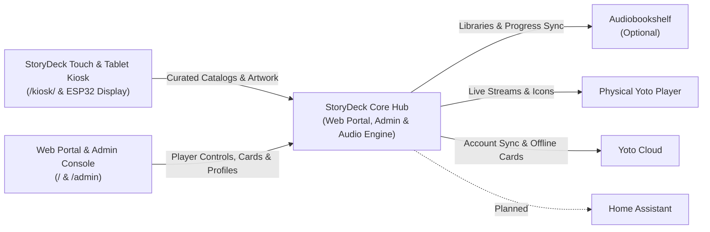

<p align="center">
  
</p>

# StoryDeck Core

An open-source, self-hosted audio hub that connects **Yoto Players**, **Audiobookshelf** libraries, **Tablet Kiosks**, and [**StoryDeck Touch**](https://github.com/YotoStoryDeck/StoryDeck-Touch) bedside displays inside a single container.

StoryDeck Core turns your audio library and Yoto cards into an intuitive, curated experience—combining a mobile-friendly Web Portal, an independent Tablet Kiosk, offline MYO card management, and multi-listener profiles with PIN-protected settings.

---

## 🧩 How It Works



---

## 🚀 Key Features

* **Web Portal (`/`) & Admin Console (`/admin`):** Control household Yoto Players from your phone or browser (volume within Yoto day/night limits, scrub seek, `±30s`, speed, sleep timers, Continue Listening), switch between **Listener Profiles** or **`🎧 My ABS`** personal listening, browse unified Audiobookshelf + Yoto libraries, and pair or manage physical MYO cards.
* **Built-In Streaming, Offline Cards & Progress Sync:** Stream audiobooks straight to Yoto Players with instant resume, or build offline MYO cards (**Next 5 Hours**, **Whole Book**, or **Whole Series** with automatic advancement to the next book) while keeping recent books cached on the player for Wi-Fi-free travel. Includes automatic chapter icon artwork and chapter lookup tools.
* **Self-Contained Tablet Kiosk (`/kiosk/`):** Turn any modern iPad (`iPadOS 14+`), Android tablet, Amazon Fire tablet, or desktop browser into a distraction-free jukebox with a shared profile switcher, fast search, source filters (automatically hidden when Audiobookshelf is not configured), Recently Played shelf, Night Clock, and a PIN-protected **Settings Menu**.
* **Listener Profiles & Content Curation:** Tailor separate libraries and daily discovery limits per listener, keep book series in order, organize Yoto cards into custom series, and protect Settings behind a 4-digit PIN.
* **Household Sign-In & Touch Hardware Management:** Supports **Admin**, **Member**, and optional **Trusted LAN Guest** access, optional Single Sign-On (`OIDC` / `ForwardAuth`), personal Audiobookshelf account matching, 1-click **StoryDeck Touch** approval and remote firmware updates, and travel proximity detection (`✈️ AWAY`) so home timers do not stop roaming Yoto Players.

---

## 🛠️ Quick Start & Deployment

### Option 1: Docker (Recommended)

Run StoryDeck Core directly from GitHub Container Registry (`GHCR`):

1. Create `docker-compose.yml` alongside a `.env` file:
   ```yaml
   services:
     storydeck-core:
       image: ghcr.io/yotostorydeck/storydeck-core:latest
       container_name: storydeck-core
       restart: unless-stopped
       ports:
         - "${PORT:-5055}:5055"
       env_file:
         - .env
       volumes:
         - ./data:/app/data
         - ./cache:/app/cache
   ```
2. Start the container:
   ```bash
   docker compose up -d
   ```

> [!NOTE]
> Everything runs inside this single container—no separate bridge service is needed. Audiobookshelf is completely optional if you only want to use StoryDeck Core with your Yoto account.

---

### Option 2: Local Development (Python 3.11+)

```bash
git clone https://github.com/YotoStoryDeck/StoryDeck-Core.git
cd StoryDeck-Core
python -m venv venv

# Windows PowerShell:
.\venv\Scripts\Activate.ps1
# Linux / macOS:
# source venv/bin/activate

pip install -r requirements.txt
cp .env.example .env
# Edit .env, then run:
python app.py
```

Once running, open `http://localhost:5055`:
* **Web Portal:** `http://localhost:5055/`
* **Sign-In:** `http://localhost:5055/login`
* **Admin Console:** `http://localhost:5055/admin` *(first-time setup wizard opens automatically)*
* **Tablet Kiosk:** `http://localhost:5055/kiosk/`

---

### Testing & Developer Documentation

* **Run the isolated test suite (`--unit-only` requires no local database or network):**
  ```bash
  python scripts/run_tests.py --unit-only -v
  ```
* Detailed test setup, optional sanitized local-DB snapshot mode (`--with-local-db`), CI workflow details, and technical authoring guidelines live in **[tests/README.md](tests/README.md)**.

---

## 🤖 AI Development Notice

This project utilizes artificial intelligence (AI) tools, including Anthropic Claude and Google Gemini / Antigravity, to assist in architectural design, code generation, testing, and documentation. All contributions are reviewed and tested by maintainers.

---

## 📜 Credits & Acknowledgments

* **Jay Heavner** ([@jayheavner](https://github.com/jayheavner)) for the original [yoto-esp32-controller](https://github.com/jayheavner/yoto-esp32-controller), hardware schematics, and touchscreen UI patterns.
* **Mylacc** ([@mylacc](https://github.com/mylacc)) for the pioneering [yoto-audiobookshelf-bridge](https://github.com/mylacc/yoto-audiobookshelf-bridge) streaming and progress synchronization engine.
* **The Yoto Community** for reverse-engineering and documenting the Yoto API ecosystem.

---

## 📄 License

This project is licensed under the [MIT License](LICENSE.md).
